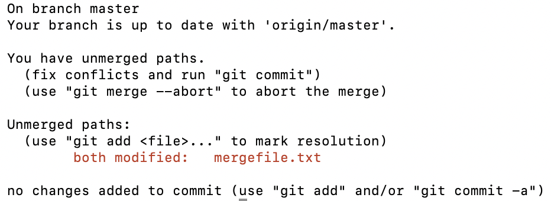
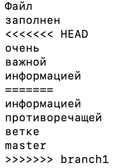
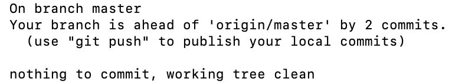
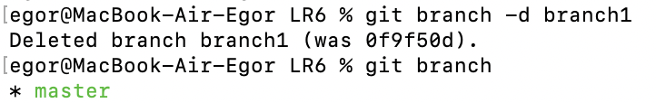
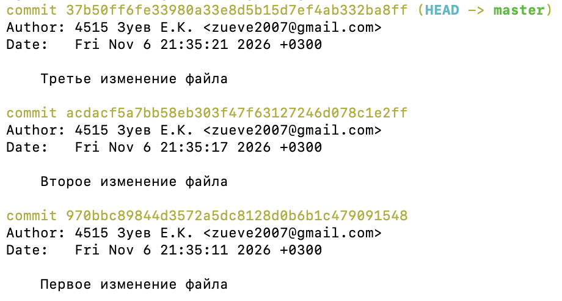
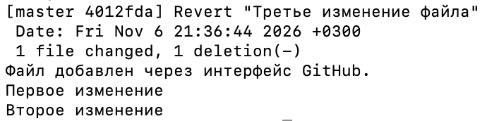
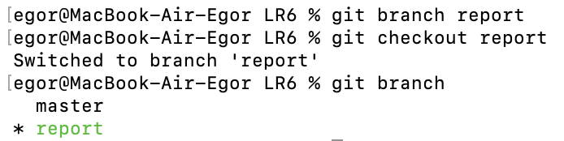
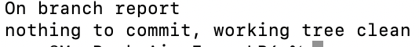

# Лабораторная работа №6. Система контроля версий

Выполнил: Зуев Егор Константинович  
Группа: 4515  
Репозиторий: [ZuevAL/LR6](https://github.com/ZuevAL/LR6)

## Цель работы

Изучение базовых возможностей системы управления версиями, получение опыта работы с Git API, локальным и удалённым репозиторием.

## Ход работы

### 1. Аккаунт GitHub

Для выполнения работы использован аккаунт GitHub `ZuevAL`.

### 2. Создание fork

Создана копия репозитория [Kurtyanik/LR6](https://github.com/Kurtyanik/LR6) в личном аккаунте. Скопированы обе ветки: `master` и `branch1`.


### 3–5. Установка, настройка Git и клонирование

Git уже установлен: версия 2.50.1 (Apple Git-155). Для автора коммитов установлено имя `4515 Зуев Е.К.`, email — `zueve2007@gmail.com`.

Личный репозиторий клонирован на компьютер. После клонирования рабочая копия размещена в `/Users/egor/Documents/Учеба/LR6`. Удалённый репозиторий `origin` связан с `https://github.com/ZuevAL/LR6.git`.

### 6. Добавление файла через GitHub и получение изменений

Через редактор GitHub в ветку `master` добавлен файл `github-file.txt`. Изменения получены в локальный репозиторий командой `git pull origin master`.


На следующем снимке показаны версия Git, настройки автора, адрес удалённого репозитория, ветки, последний коммит и наличие полученного файла.


### 7. История каждой ветки

Получена история веток `master` и `origin/branch1`.


### 8. Последние изменения

Просмотрены последние коммиты и изменения файлов в обеих ветках. В `master` добавлен файл `github-file.txt`; в `branch1` изменён `mergefile.txt`.


### 9. Слияние веток и разрешение конфликта

Создана локальная ветка `branch1` из `origin/branch1`. При её слиянии в `master` возник конфликт в `mergefile.txt`.



В файле обнаружены маркеры `<<<<<<< HEAD`, `=======` и `>>>>>>> branch1`, разделяющие варианты текста двух веток.



В текстовом редакторе варианты объединены, маркеры конфликта удалены. Сохранён следующий текст:

```text
Файл
заполнен
очень
важной
информацией
противоречащей
ветке
master
```

Файл добавлен в индекс, слияние завершено коммитом `28dea7d` с комментарием «Разрешен конфликт при слиянии branch1 в master».



### 10. Удаление побочной ветки

После успешного слияния локальная ветка `branch1` удалена командой `git branch -d branch1`.



### 11. Изменения и коммиты

В `github-file.txt` последовательно добавлены строки «Первое изменение», «Второе изменение» и «Третье изменение». Каждое изменение зафиксировано отдельным коммитом с комментарием:

- `970bbc8` — «Первое изменение файла»;
- `acdacf5` — «Второе изменение файла»;
- `37b50ff` — «Третье изменение файла».



### 12. Откат коммита

Командой `git revert --no-edit HEAD` отменён последний коммит. Создан коммит отката `4012fda`; строка «Третье изменение» удалена, первые два изменения сохранены.



### 13. Ветка для отчёта

Создана ветка `report`, выполнено переключение на неё.



### 14. Оформление отчёта

Отчёт оформляется в `README.md` с использованием Markdown. Снимки экрана консоли и браузера находятся в отдельной папке `screenshots`. Лог команд приведён ниже без результатов их выполнения.

В ходе оформления первая часть отчёта (пункты 1–8) зафиксирована коммитом `3c96dfd` с комментарием «Начат отчет: пункты 1–8». После фиксации рабочее дерево чистое.



## Лог команд

```bash
git --version
git config --global user.name '4515 Зуев Е.К.'
git config --global --get user.name
git config --global --get user.email
git clone https://github.com/ZuevAL/LR6.git outputs/LR6
cd outputs/LR6
git status --short --branch
git branch -a
git remote -v
cd "/Users/egor/Documents/Учеба/LR6"
git --version
git config --get user.name
git config --get user.email
git remote -v
git branch -a
git status --short --branch
git pull origin master
git status --short --branch
git log -1 --oneline
cat github-file.txt
git log
git log origin/branch1
git show
git show origin/branch1
git checkout master
git branch branch1 origin/branch1
git merge branch1
git status
cat mergefile.txt
open -e mergefile.txt
git add mergefile.txt
git commit -m "Разрешен конфликт при слиянии branch1 в master"
git status
git branch -d branch1
git branch
echo "Первое изменение" >> github-file.txt
git add github-file.txt
git commit -m "Первое изменение файла"
echo "Второе изменение" >> github-file.txt
git add github-file.txt
git commit -m "Второе изменение файла"
echo "Третье изменение" >> github-file.txt
git add github-file.txt
git commit -m "Третье изменение файла"
git log
git revert --no-edit HEAD
cat github-file.txt
git branch report
git checkout report
git branch
git add README.md screenshots
git commit -m "Начат отчет: пункты 1–8"
git status
```
