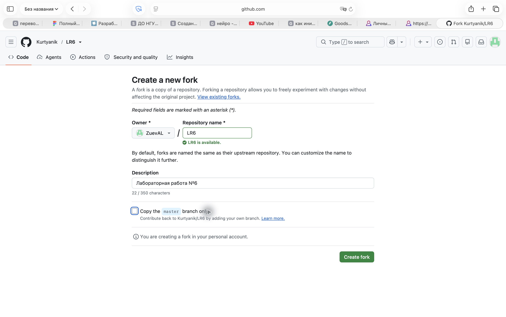
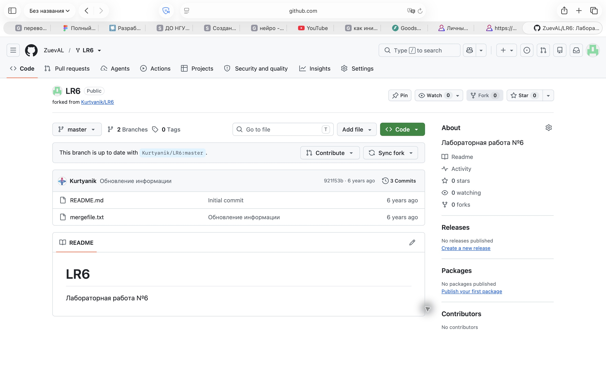
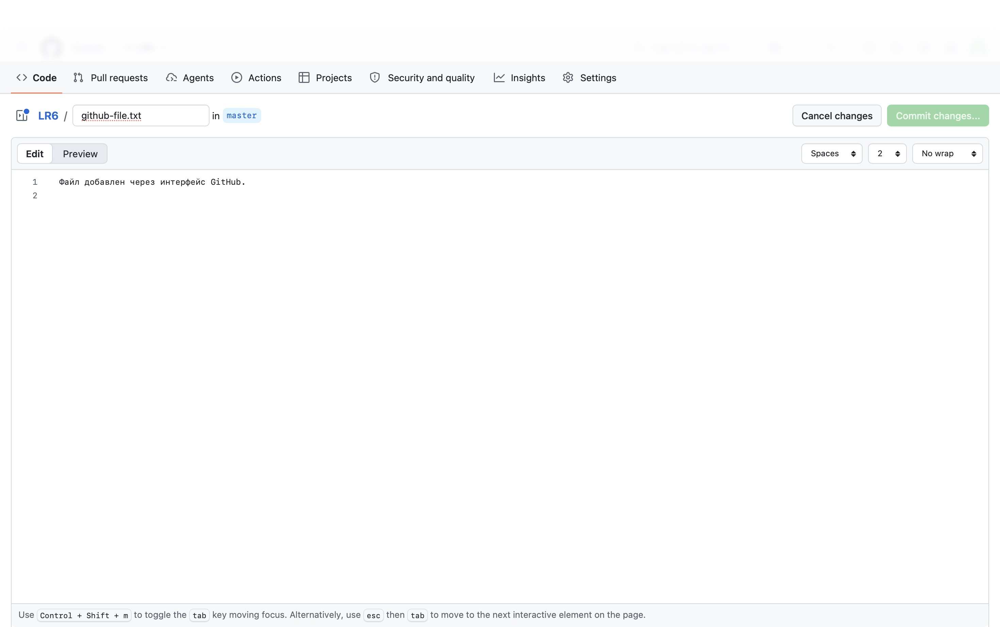
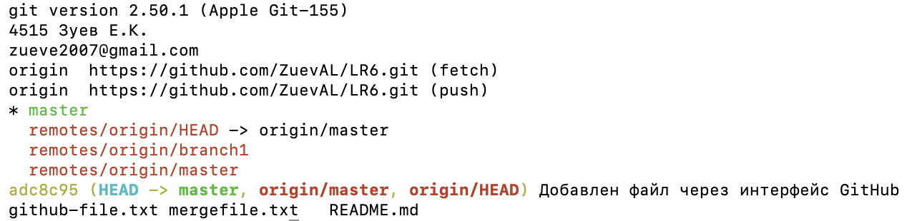
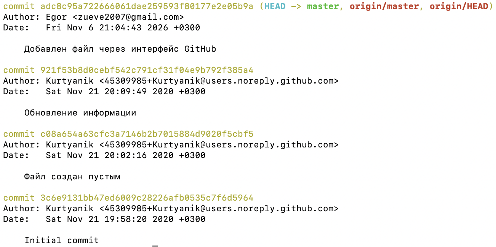
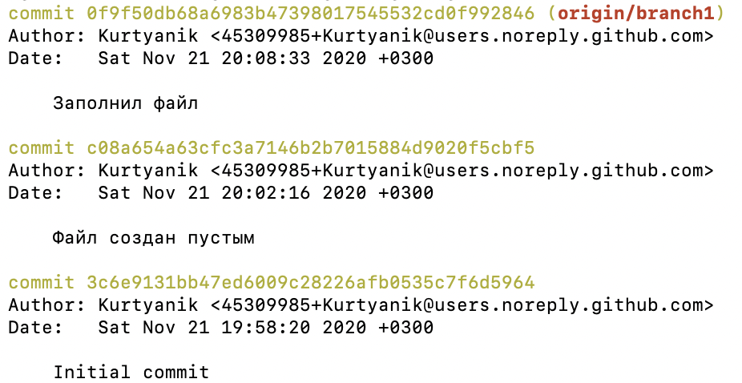
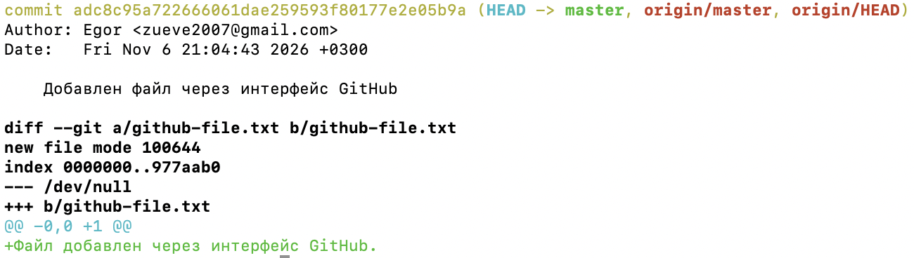
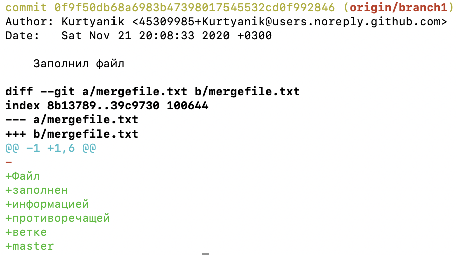

# Лабораторная работа №6. Система контроля версий

Выполнил: Зуев Егор Константинович  
Группа: 4515  
Репозиторий: [ZuevAL/LR6](https://github.com/ZuevAL/LR6)

## Цель работы

Изучение базовых возможностей системы управления версиями, получение опыта работы с Git API, локальным и удалённым репозиторием.

## Ход работы

### 1. Аккаунт GitHub

Для выполнения работы использован аккаунт GitHub `ZuevAL`.

### 2. Создание fork

Создана копия репозитория [Kurtyanik/LR6](https://github.com/Kurtyanik/LR6) в личном аккаунте. Скопированы обе ветки: `master` и `branch1`.





### 3–5. Установка, настройка Git и клонирование

Git уже установлен: версия 2.50.1 (Apple Git-155). Для автора коммитов установлено имя `4515 Зуев Е.К.`, email — `zueve2007@gmail.com`.

Личный репозиторий клонирован на компьютер. После клонирования рабочая копия размещена в `/Users/egor/Documents/Учеба/LR6`. Удалённый репозиторий `origin` связан с `https://github.com/ZuevAL/LR6.git`.

### 6. Добавление файла через GitHub и получение изменений

Через редактор GitHub в ветку `master` добавлен файл `github-file.txt`. Изменения получены в локальный репозиторий командой `git pull origin master`.



На следующем снимке показаны версия Git, настройки автора, адрес удалённого репозитория, ветки, последний коммит и наличие полученного файла.



### 7. История каждой ветки

Получена история веток `master` и `origin/branch1`.





### 8. Последние изменения

Просмотрены последние коммиты и изменения файлов в обеих ветках. В `master` добавлен файл `github-file.txt`; в `branch1` изменён `mergefile.txt`.





## Лог команд

```bash
git --version
git config --global user.name '4515 Зуев Е.К.'
git config --global --get user.name
git config --global --get user.email
git clone https://github.com/ZuevAL/LR6.git outputs/LR6
cd outputs/LR6
git status --short --branch
git branch -a
git remote -v
cd "/Users/egor/Documents/Учеба/LR6"
git --version
git config --get user.name
git config --get user.email
git remote -v
git branch -a
git status --short --branch
git pull origin master
git status --short --branch
git log -1 --oneline
cat github-file.txt
git log
git log origin/branch1
git show
git show origin/branch1
```
